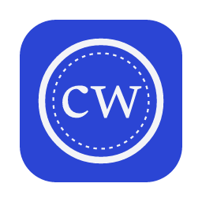

<p align="center">
  
</p>

<h1 align="center">Codebase Wiki</h1>

<p align="center">
  A desktop control panel for the project wikis that coding agents keep.<br>
  Review what agents did, sign off on what only a person can approve, and give agents local code search.
</p>

<p align="center">
  <a href="https://github.com/StefanoHernandez/codebase-wiki-app/releases/latest"></a>
  <a href="LICENSE"></a>
  
</p>

---

Codebase Wiki is the companion app of [Codebase Wiki LLM](https://github.com/StefanoHernandez/codebase-wiki-llm),
a plugin for Claude Code, Codex and Antigravity that keeps an evidence-backed wiki inside your
repository: a work tracker, a log, decisions, risks and a handoff for the next agent session.

The agents write the wiki. The app is where a person reads it, sees what needs attention and
records the decisions that agents are not allowed to make: closing a task without proof,
accepting a decision, confirming that a page is still true. Every change is a small, surgical
edit to the Markdown files in your repository, plus a log entry.

The interface is available in English and Italian.

## Features

| View | What it is for |
| --- | --- |
| **Projects** | Recent repositories, what changed since you last looked, recent agent activity. |
| **For you** | Everything waiting for a person: proposed decisions, stale handoff, pages to re-verify, high risks without an owner. |
| **Work** | The tracker as a board: open, proposals and done. Promote a proposal, change an owner, close a task. |
| **Decisions** | Decision records; accept or reject a proposed one, with the approval written into the record. |
| **Handoff** | The state and the baton the next agent session starts from. |
| **Health** | Structural check of the wiki (the plugin's own validator), read budgets and the risk register. |
| **Graph** | Wiki pages and the source files they describe, with drift; **History** replays how the wiki grew, commit by commit. |
| **Search** | A local index of the code, served to agents over MCP as `search_code`. |
| **Settings** | Embedding models, agent connections, plugin install and update, app updates, theme and language. |

**Local code search.** The app indexes the repository with a small embedding model that runs on
your machine (ONNX, no API key) and connects the `codebase-wiki` MCP server to Claude Code, Codex
or Cursor. Agents then find *where* and *how* in the code before grepping, and keep reading the
wiki for status, decisions and *why*.

**Updates.** The app checks for a new release at start and once a day, and for agents whose plugin
is behind. Nothing is installed without your click.

## Install

Download the package for your system from the
[latest release](https://github.com/StefanoHernandez/codebase-wiki-app/releases/latest):

| System | Package |
| --- | --- |
| macOS on Apple Silicon | `.dmg` |
| Windows 10/11 (x64) | `.exe` installer or `.msi` |
| Linux (x64) | `.AppImage`, `.deb` or `.rpm` |

macOS builds are ad-hoc signed: the first time, right-click the app and choose **Open**.
Intel Macs are not supported (ONNX Runtime ships no prebuilt binaries for them).

### Requirements

- **Git.**
- **The Codebase Wiki LLM plugin** in the agent you use. The app can install or update it for you
  from Settings.
- **A wiki in format 0.12.0 or later** (plugin 0.12+). An older wiki opens read-only, with the
  prompt that upgrades it (`/wiki-init --adopt`).
- **Python 3.10 or later**, optional: needed only for the structural check in Health. The app looks
  for it in Settings, then `python3.13`…`python3.10`, `python3` and `python` on the `PATH`,
  `/opt/homebrew/bin`, `/usr/local/bin`, `~/.pyenv/shims` and, on Windows, `py -3`. Without it,
  Health says so and everything else works.

## Getting started

1. Open the app and choose a Git repository that has a wiki (`wiki/`, or the folder named in
   `.wikidir`). No wiki yet? **Getting started** gives you the `/wiki-init` prompt for your agent.
2. Set your name in **Settings**: it signs the actions you take (`human:<id>` in the wiki).
3. Optional: in **Search**, download a model and index the project, then connect your agents from
   **Settings → Connect to agents**.

## Privacy

Your code and your wiki stay on your machine. The app reads and writes only the wiki folder of the
repository you open, and keeps its search indexes and models in its own data folder. It goes online
only to:

- check GitHub for app and plugin releases;
- download the embedding models you choose from Hugging Face.

There is no telemetry.

## How the app writes to a wiki

The app follows the plugin's formats, so agents and the validator read its edits like their own.

| Action | What is written |
| --- | --- |
| Close a task without proof (⚫) | `Criteria met`: `closed by <person> YYYY-MM-DD; not proven: <what>`; `Evidence`: where the closure comes from. |
| Accept or reject a decision | Only from `status: proposed`; the frontmatter status changes and a line is added under `## Approval`. |
| Mark a page as reviewed | `verified: { by: human:<id>, at: <ISO 8601 Z>, commit: <sha> }` in the frontmatter. |

Each action re-reads the file from disk, changes only the target row or line, writes atomically and
adds a log entry (`## YYYY-MM-DD · <title> · human`). If the row changed in the meantime, the action
stops instead of overwriting.

## Development

Requirements: Node.js 22+, Rust stable (the CI uses 1.90), Python 3.10+, and on Linux
`libwebkit2gtk-4.1-dev libappindicator3-dev librsvg2-dev patchelf libgtk-3-dev`.

```bash
npm install
npm run tauri dev        # run the app
npm test                 # TypeScript tests
cargo test --workspace   # Rust tests
npm run build:app        # local macOS build, without update artifacts
```

Project layout:

```text
src/                 React interface (views, components, i18n dictionaries)
src-tauri/           Tauri shell and commands
crates/wiki-core/    wiki parsing, validation and safe writes
crates/rag-core/     code index, embedding models, agent connections
crates/wiki-mcp/     codebase-wiki-mcp: the MCP server and CLI
resources/           validate-wiki.py, an exact copy of the plugin's validator
wiki/                this project's own wiki, kept with the plugin
```

The CI ([`build.yml`](.github/workflows/build.yml)) tests on Ubuntu and builds macOS, Windows and
Linux packages. Tag builds sign the update artifacts.

## Contributing

Issues and pull requests are welcome. Contributors are listed in [CONTRIBUTORS.md](CONTRIBUTORS.md).

## License

[MIT](LICENSE) © 2026 Stefano Hernandez
