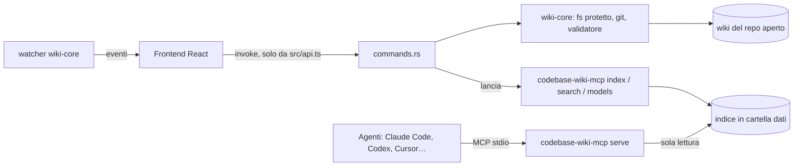

# Architettura

## Componenti

| Componente | Dove | Cosa fa |
| --- | --- | --- |
| Frontend | `src/` (React 18, TypeScript, Vite) | viste Progetti, Primi passi, Per te, Lavori, Decisioni, Handoff, Salute, Grafo (con la Storia), Ricerca, Impostazioni (anche installazione del plugin); calcola le modifiche alla wiki ([app](modules/app.md)) |
| Backend Tauri | `src-tauri/src/` | comandi invocati dal frontend (`commands.rs`), processi del sidecar di ricerca (`rag_jobs.rs`, `rag_sidecar.rs`) |
| `wiki-core` | `crates/wiki-core/` | risoluzione della wiki, lettura e scrittura protette, validatore, watcher, git ([wiki-core](modules/wiki-core.md)) |
| `rag-core` | `crates/rag-core/` | elenco file, chunk, indice SQLite, catalogo e download dei modelli, config degli agenti ([rag](modules/rag-mcp.md)) |
| `wiki-mcp` | `crates/wiki-mcp/` | eseguibile `codebase-wiki-mcp`: CLI `index`/`search`/`status`/`models` e server MCP `serve` |
| Validatore | `resources/validate-wiki.py` | copia identica di quello del plugin 0.14.0, lanciata con `--json` |

## Flusso

- Il frontend chiama il backend solo tramite `src/api.ts` (unico import di `@tauri-apps`).
- Le azioni umane: il frontend calcola la modifica, il backend rilegge il file dal disco al
  momento della conferma e scrive in modo atomico (file temporaneo + rinomina), la voce di log per ultima.
- La ricerca: l'app non contiene ONNX; lancia l'eseguibile come sidecar e legge le sue righe
  JSON (`rag://progress`). Il server MCP è lo stesso eseguibile, avviato dagli agenti.

## Invarianti

- Ogni comando con `repo` richiede un progetto aperto dall'utente (presente nei recenti e repo git).
- Nessuna scrittura fuori dalla cartella della wiki; `.private-terms` mai letto né scritto
  dall'interfaccia, i link simbolici non vengono seguiti.
- CSP restrittiva: `default-src 'self'`, niente immagini remote (`src-tauri/tauri.conf.json`).
- Un solo processo scrive un indice; il server MCP legge soltanto.
- Cartella dati: `<data_local_dir>/com.codebasewiki.app/rag` (`config.json`, `models/`,
  `indexes/<repo_id>.sqlite`, `bin/codebase-wiki-mcp`), sovrascrivibile con `CODEBASE_WIKI_DATA_DIR`.

Decisioni collegate: [0001](project/decisions/0001-riscrittura-tauri-v2.md),
[0002](project/decisions/0002-rag-server-mcp-separato.md), [0004](project/decisions/0004-rag-solo-codice.md).
