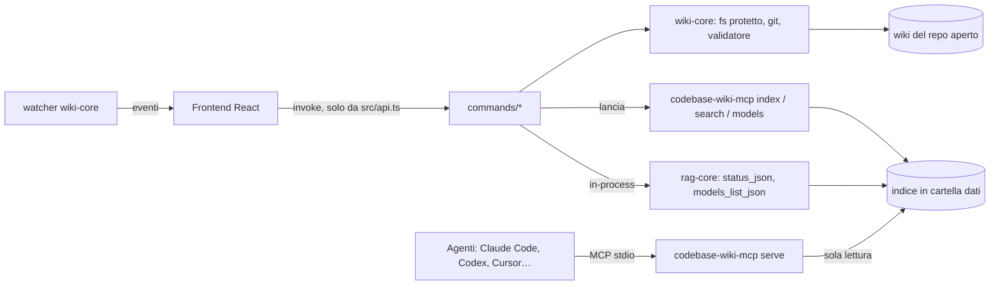

# Architettura

## Componenti

| Componente | Dove | Cosa fa |
| --- | --- | --- |
| Frontend | `src/` (React 18, TypeScript, Vite) | viste Progetti, Primi passi, Per te, Lavori, Decisioni, Handoff, Salute, Grafo (Mappa / Grafo / Elenco + Storia), Ricerca, Impostazioni; calcola le modifiche alla wiki ([app](modules/app.md)) |
| Backend Tauri | `src-tauri/src/` | comandi invocati dal frontend (`commands/{mod,python,rag,plugin}.rs`), gestione e arresto pulito dei job RAG (`rag_jobs.rs` su `RunEvent::Exit`), sidecar (`rag_sidecar.rs`) |
| `wiki-core` | `crates/wiki-core/` | risoluzione della wiki, lettura e scrittura protette, validatore, watcher, git ([wiki-core](modules/wiki-core.md)) |
| `rag-core` | `crates/rag-core/` | elenco file, chunk, indice SQLite + lettura in-process (`status_json`, `models_list_json`), catalogo e download modelli, config agenti ([rag](modules/rag-mcp.md)) |
| `wiki-mcp` | `crates/wiki-mcp/` | eseguibile `codebase-wiki-mcp`: CLI `index`/`search`/`status`/`models` e server MCP `serve` |
| Validatore | `resources/validate-wiki.py` | copia identica di quello del plugin 0.16.0, lanciata con `--json` |

## Flusso

- Il frontend chiama il backend e gli eventi Tauri solo tramite `src/api.ts` (unico punto di import di `@tauri-apps/*`, verificato dal guardrail in `tests/edits-exact.test.ts`).
- Le azioni umane: il frontend calcola la modifica, il backend rilegge il file dal disco al
  momento della conferma e scrive in modo atomico (file temporaneo + rinomina), la voce di log per ultima.
- La ricerca: `rag_status` e `rag_models` leggono indice e catalogo direttamente in-process tramite `rag-core`; per `index`, `search` e download/ricerca modelli l'app non contiene ONNX e lancia `codebase-wiki-mcp` come sidecar leggendo le righe JSON (`rag://progress`). Alla chiusura della finestra/app (`RunEvent::Exit`), `RagJobs::shutdown()` termina eventuali processi sidecar attivi. Il server MCP è lo stesso eseguibile, avviato dagli agenti.

## Invarianti

- Ogni comando che opera su `repo` (snapshot, wiki, git, watcher e tutti i comandi `rag_*` per progetto: stato, indicizzazione, annullamento, eliminazione indice, anteprima ricerca) richiede un progetto aperto dall'utente (`opened_repo`, presente nei recenti e repo git canonico).
- Nessuna scrittura fuori dalla cartella della wiki; `.private-terms` mai letto né scritto
  dall'interfaccia, i link simbolici non vengono seguiti.
- CSP restrittiva: `default-src 'self'`, niente immagini remote (`src-tauri/tauri.conf.json`).
- Un solo processo scrive un indice; il server MCP legge soltanto.
- Cartella dati: `<data_local_dir>/com.codebasewiki.app/rag` (`config.json`, `models/`,
  `indexes/<repo_id>.sqlite`, `bin/codebase-wiki-mcp`), sovrascrivibile con `CODEBASE_WIKI_DATA_DIR`.

Decisioni collegate: [0001](project/decisions/0001-riscrittura-tauri-v2.md),
[0002](project/decisions/0002-rag-server-mcp-separato.md), [0004](project/decisions/0004-rag-solo-codice.md).
